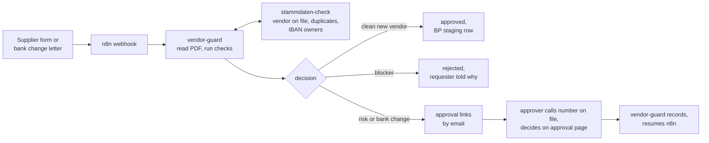
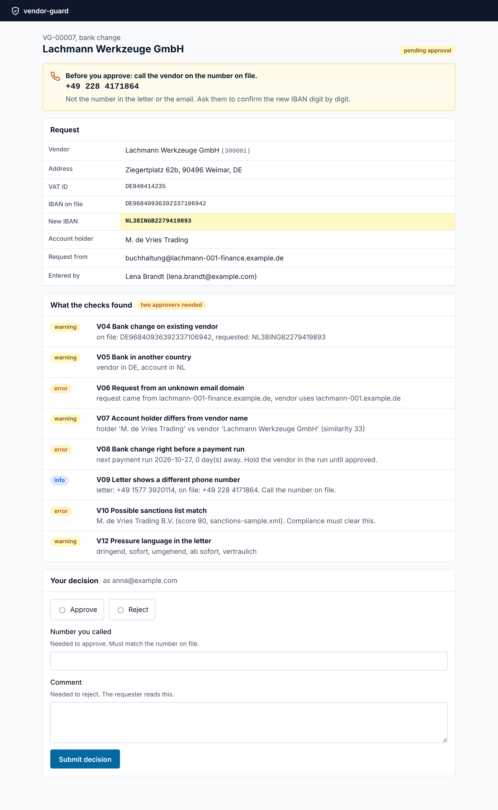
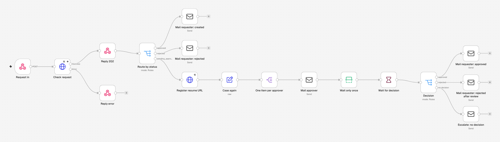

# vendor-guard

All companies, people and bank accounts in this repo are invented. Test IBANs are generated with valid check digits but belong to nobody.

**Kurzfassung (DE).** Prüft neue Lieferanten und Änderungen der Bankverbindung, bevor sie in die Stammdaten gehen. Ein n8n-Workflow nimmt die Anfrage samt PDF an, vendor-guard liest IBAN, USt-IdNr. und HRB aus dem Dokument, gleicht mit den Stammdaten ab (Dubletten, IBAN bei anderem Partner, Absender-Domain, Kontoinhaber, Zahllauf-Nähe, EU-Sanktionsliste) und entscheidet: freigegeben, abgelehnt oder Vier-Augen-Prüfung. Bei Bankänderungen muss der Freigebende die Telefonnummer aus dem Stammsatz zurückrufen und eintragen. Jede Aktion steht in einem signierten Audit-Log.

## The problem

A supplier's accountant sends a letter: new bank, please pay to this IBAN from now on. Somebody in accounts payable updates the vendor and the next payment run sends the money there. Most of the time that is fine. Sometimes the letter came from a fraudster, and the money is gone. German police and insurers have been warning Mittelstand companies about this for years, and it keeps working because the check depends on one person on a busy day.

Big companies have supplier management suites with dual control built in. Smaller ones have an email inbox and SAP transaction XK02. This project sits in between: a workflow that catches the letter, checks it against the master data, and forces the second look exactly where it matters.

It is the second half of [stammdaten-check](https://github.com/abdallahaneed/stammdaten-check). That one cleans the vendor master before an S/4HANA move. This one keeps it clean afterwards.

## What happens to a request



## The checks

| Rule | Looks for | Severity |
|---|---|---|
| V01 | Field problems from stammdaten-check: required fields, postal code, VAT ID, IBAN check digits | blocker rejects |
| V02 | Vendor already exists (new vendors only) | error |
| V03 | IBAN already stored for another vendor or customer | error |
| V04 | Any bank change on an existing vendor | always needs an approver |
| V05 | Bank country differs from vendor country | warning |
| V06 | Request sent from a domain the vendor does not use | error, two approvers |
| V07 | Account holder differs from vendor name | warning |
| V08 | Change within two days of the next payment run | error, two approvers |
| V09 | IBAN or VAT ID in the PDF differs from the form, or the letter shows a different phone number | error / info |
| V10 | Name close to an entry on the EU consolidated sanctions list | error, two approvers, never blocks alone |
| V11 | VAT ID invalid at EU VIES (optional) | error |
| V12 | Pressure words in the letter: "dringend", "ab sofort", "vertraulich" ... | warning |

Which risk each rule answers, and what it does not cover, is in [docs/controls.md](docs/controls.md).

## The approval page



The approver gets a personal link (signed, 48 hours, works once). The requester never gets one. For a bank change the page shows the phone number from the master record and asks for the number that was called. If it does not match, approval is refused.

## Run it

Needs Docker Desktop, and stammdaten-check checked out next to this folder:

```
Desktop/
  stammdaten-check/
  vendor-guard/
```

```bash
cp .env.example .env        # then set LINK_SECRET and AUDIT_KEY, each from: openssl rand -hex 32
docker compose up --build
```

| What | Where |
|---|---|
| n8n | http://localhost:5678 |
| vendor-guard cases and approvals | http://localhost:8100 |
| stammdaten-check dashboard | http://localhost:8000 |
| Mailpit, every email the workflow sends | http://localhost:8025 |

One-time setup:

```bash
# workflows and credentials into n8n (edit the API key in the file first)
docker compose exec n8n n8n import:credentials --input=/workflows/credentials/credentials.example.json
docker compose exec n8n n8n import:workflow --separate --input=/workflows
# master data for the checks: a sample run in stammdaten-check
curl -X POST -H "X-API-Key: <STAMMDATEN_API_KEY>" -F sample=true http://localhost:8000/api/v1/runs
# optional: the real EU sanctions list
docker compose exec vendor-guard vendor-guard sanctions-update --out /data/eu-sanctions.xml
docker compose restart vendor-guard
```

Then open n8n and publish all three workflows, the error workflow too. Without that n8n does not run them. Then send the demo requests:

```bash
pip install -e .
vendor-guard samples                    # builds four requests from the sample vendors
vendor-guard send samples/4-bank-change-fraud.json
```

The approver emails show up in Mailpit. Open a link, decide, and watch n8n continue.



The workflows are explained node by node, including how they map to Power Automate, in [docs/n8n.md](docs/n8n.md).

## API

| Method | Path | |
|---|---|---|
| POST | /api/v1/cases | check a request, open a case. `Idempotency-Key` header makes retries safe |
| POST | /api/v1/cases/{caseId}/resume-url | n8n registers where to send the decision |
| GET | /api/v1/cases, /api/v1/cases/{caseId} | cases with findings, decisions and audit trail |
| GET | /api/v1/audit/head | newest audit hash, for keeping a copy elsewhere |
| GET | /api/v1/audit/verify | recompute the whole chain |

OpenAPI docs at http://localhost:8100/docs.

## Tests

```bash
pip install -e ".[dev]"
pytest
```

23 tests: extraction from generated PDFs, every rule, the decision logic, the approval flow (wrong callback number, used links, forged and expired links, reject without reason, two approvers), idempotency, API key, an audit chain that has been tampered with, and refusing to start with weak secrets.

## Known limitations

- The approval link proves access to a mailbox, not who the person is. A real rollout puts the page behind the company login.
- No OCR. Scanned letters without a text layer are not read, the case then relies on the form fields.
- The payment run calendar is a weekday rule, not the real F110 schedule.
- Changes made directly in SAP bypass all of this. In SAP that gap needs dual control on sensitive fields (FK08/FK09).
- The demo sanctions file in `tests/fixtures` is invented. Use `sanctions-update` for the real list.
- The case pages and the read endpoints have no login. Docker Compose therefore publishes every port on 127.0.0.1 only, so other machines on the network cannot reach them. The two API keys in `.env.example` are placeholders for a local demo.

## Layout

```
vendor_guard/   API, checks, PDF extraction, sanctions screening, signed links, audit log, pages
n8n/            workflow exports, example credentials in n8n/credentials
docs/           controls, decisions, n8n walkthrough
tests/          pytest, with a fake stammdaten-check
```

## License

MIT
