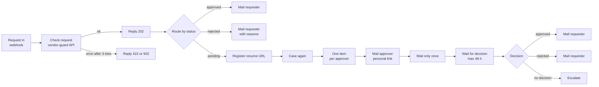

# The n8n workflows

Three workflows in the `n8n` folder. Import them, create two credentials, publish all three. In n8n 2.x a workflow only runs on its trigger once it is published, and that includes the error workflow.

## Vendor request

Node by node, and why it looks like this:

| Node | What it does | Why |
|---|---|---|
| Request in | Webhook, POST `/webhook/vendor-request`, answers through a Respond node | The caller gets the case number at once, the rest runs on |
| Check request | POST to vendor-guard `/api/v1/cases`, header auth, Idempotency-Key from the caller or the execution id. Retries 3 times, 2 s apart. Errors go to the second output. | A retried call must not open a second case. Bad input should answer the caller, not crash the workflow. |
| Reply 202 / Reply error | Respond to Webhook | 202 because the decision comes later. On an error: 422 when vendor-guard rejected the input, 502 when it could not be reached. |
| Route by status | Switch on `status` | approved, rejected, pending_approval |
| Register resume URL | Sends `$execution.resumeUrl` to vendor-guard | vendor-guard calls it after the last decision. The decision lives in vendor-guard, so a forwarded n8n URL cannot approve anything. |
| Case again | Set node, raw JSON from the Check request node | The resume URL call returns nothing, the next nodes need the case |
| One item per approver | Split Out on `approvalLinks`, keeps the other fields | Each approver gets their own link |
| Mail approver | SMTP | Personal link, the findings, and the callback rule |
| Wait only once | Limit to 1 item | Otherwise the Wait node would run once per approver |
| Wait for decision | Wait, resume on webhook call, limit 48 hours | No polling. Times out into the escalation branch. |
| Decision | Switch on `body.status`, fallback output "no decision" | Timeout has no body, so it lands in the fallback |
| Escalate | Mail to admin and requester | Nobody decided, the vendor stays blocked for payment |

Workflow setting: error workflow = "Vendor request errors".

## Vendor request errors

Error Trigger, then one email to `ADMIN_EMAIL` with workflow, execution, failed node and message. It catches everything the node-level error handling does not, for example SMTP being down.

## Audit anchor

Every evening at 18:00: read the latest audit hash, verify the whole chain, email both to controlling. The emails are the outside copy of the log head. If someone rewrites the database and the hash chain with it, the hash of an old day stops matching the email from that day.

## The same thing in Power Automate

Most Microsoft 365 companies would build this in Power Automate. The pieces map like this:

| n8n | Power Automate |
|---|---|
| Webhook + Respond to Webhook | "When an HTTP request is received" + "Response" |
| HTTP Request with header auth | HTTP action, or a custom connector for vendor-guard |
| Retry on fail | Retry policy on the action (exponential) |
| Error output, error workflow | "Configure run after" (has failed) inside a Scope, plus a Catch scope |
| Switch | Switch |
| Split Out + email | Apply to each + "Send an email (V2)" |
| Wait on webhook with `$execution.resumeUrl` | "HTTP Webhook" action, or simpler: "Start and wait for an approval" with Approvals |
| Schedule Trigger | Recurrence |

With Power Automate you would probably let the Approvals connector handle the approval links. The four-eyes rule and the callback check would then have to move into the approval form and a condition after it, because the Approvals connector cannot check that the approver called the number on file.

## Credentials

Create them in n8n under Credentials, or import `n8n/credentials/credentials.example.json` after editing it. It sits in its own folder so the workflow import does not try to read it as a workflow.

| Name | Type | Values |
|---|---|---|
| vendor-guard API key | Header Auth | Name `X-API-Key`, value = `VENDOR_GUARD_API_KEY` |
| Mailpit SMTP | SMTP | host `mailpit`, port 1025, no user, SSL off |

The workflow JSON only references credentials by id and name. No secret is in the repo.
